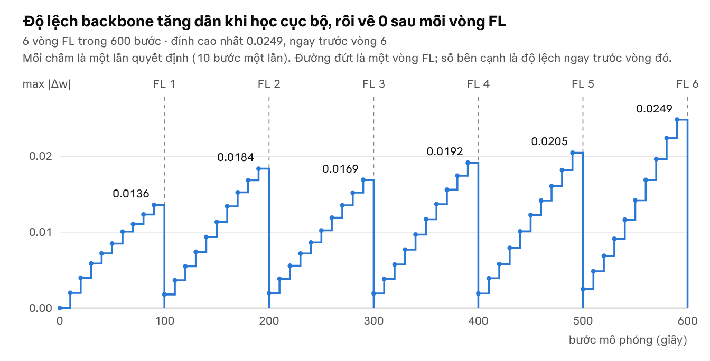

# Báo cáo phân tích Federated Learning — demo FedMARL-ATSC

> **Ngày**: 2026-11-15 · **Nguồn số liệu**: `cityflow/sample/demo_fl/render/fl_log.json` (60 lần quyết định, 6 vòng FL) và `fl_chart.txt` (600 bước), sinh bởi `python main_demo_fl.py` ở chế độ `--trainer local`, seed 42.

---

## 1. Tóm tắt

Cơ chế Federated Learning chạy đúng trong cả 6 vòng, nhưng chính sách điều khiển đèn chưa học được gì đáng kể. Lần chạy này chứng minh luồng trao đổi trọng số, chưa chứng minh FL cải thiện giao thông.

- **Đồng bộ thành công 6/6 vòng.** Sau mỗi vòng, độ lệch backbone giữa hai node về đúng 0.
- **Chỉ backbone rời node.** Mỗi vòng, mỗi node gửi 30.016 tham số (117,25 KB, 10 tensor). `local_policy_head` không đổi trong cả 12 lần kiểm tra.
- **Các node trôi xa nhau khi học cục bộ.** Giữa hai vòng, độ lệch tăng trung bình 0,0019 mỗi lần quyết định và đạt 0,014–0,025 trước khi đồng bộ.
- **FedAvg ở đây là trung bình cộng.** Hai node luôn có cùng số mẫu `n_k`, nên hệ số là 0,5 và 0,5.
- **Chất lượng điều khiển xấu dần.** Reward trung bình của Node_1 giảm từ −6,9 (100 bước đầu) xuống −56,7 (100 bước cuối), loss tăng theo.

---

## 2. Thiết lập thí nghiệm

Lần chạy dùng chế độ huấn luyện cục bộ `local`, không gọi API bên ngoài, trên lưới 1×2 giao lộ của CityFlow.

| Tham số | Giá trị |
|---|---|
| Node tham gia | 2: `intersection_1_1` (Node_1), `intersection_2_1` (Node_2) |
| Thời lượng mô phỏng | 600 bước, 1 bước = 1 giây |
| Chu kỳ ra quyết định | 10 bước, tức 60 lần mỗi node |
| Chu kỳ FL | 100 bước, tức 6 vòng |
| Thuật toán tổng hợp | FedAvg có trọng số `n_k`, không phân cụm |
| Huấn luyện cục bộ | Q-learning một bước, γ = 0,99, learning rate = 0,001, ε = 0,3 |
| Reward | Composite Max-Pressure: α = 0,6, β = 0,4, phạt đổi pha 0,05 |
| State và action | State 36 chiều (queue, speed, density của 12 làn), 4 pha xanh |
| Phần được liên bang | `shared_feature_extractor`: 10 tensor, 30.016 tham số |
| Phần giữ tại node | `local_policy_head` và toàn bộ dữ liệu giao thông thô |

---

## 3. Quá trình hoạt động của FL

Mỗi chu kỳ 100 bước gồm một giai đoạn học cục bộ rồi một vòng trao đổi trọng số ba chặng. Dữ liệu giao thông không bao giờ rời node; chỉ trọng số backbone được gửi đi.

1. **Vòng 0, khởi tạo chung.** Trước khi mô phỏng, server phát một backbone w⁰ cho cả hai node. Vì vậy độ lệch tại bước 0 bằng 0.
2. **Học cục bộ.** Cứ 10 bước, mỗi node quan sát state, nhận reward của hành động trước và cập nhật mạng bằng Q-learning. Cả backbone lẫn head đều thay đổi, và `n_k` tăng thêm 1.
3. **Uplink, node gửi lên server.** Tại bước thứ 100, mỗi node gửi backbone của mình (30.016 tham số, 117,25 KB) kèm `n_k`. Head ở lại node.
4. **Aggregate, server tổng hợp.** Server lấy trung bình có trọng số theo công thức FedAvg bên dưới để ra backbone toàn cục w\*.
5. **Downlink, server phát về node.** Mỗi node thay backbone của mình bằng w\* và đặt `n_k` về 0. Head giữ nguyên, nên mỗi giao lộ vẫn có chính sách riêng.
6. **Lặp lại** từ bước 2 cho chu kỳ kế tiếp.

$$w^{*} = \sum_{k=1}^{K} \frac{n_k}{\sum_j n_j}\, w_k^{\text{backbone}}$$

Ví dụ thật ở vòng 1, phần tử [85] của tensor `0.weight`: 0,5 × 0,07258 + 0,5 × 0,06160 = 0,06709.

Ở vòng 1 mỗi node chỉ có `n_k` = 9 thay vì 10. Lần quyết định đầu tiên chưa có transition (s, a, r, s') nào để học.

---

## 4. Phân tích kết quả

### 4.1 Trao đổi trọng số qua 6 vòng

Mỗi vòng FL kéo backbone của mỗi node đi 1,3–2,0% so với độ lớn của nó, tức hai node chưa trôi xa nhau.

| Vòng | Tại bước | `n_k` mỗi node | Hệ số mỗi node | ‖w\*−w_k‖ | So với ‖w_k‖ | ‖w\*‖ |
|---|---|---|---|---|---|---|
| 1 | 100 | 9 | 0,5 | 0,2753 | 1,25% | 21,9931 |
| 2 | 200 | 10 | 0,5 | 0,4494 | 2,04% | 21,9909 |
| 3 | 300 | 10 | 0,5 | 0,3756 | 1,71% | 21,9923 |
| 4 | 400 | 10 | 0,5 | 0,3441 | 1,56% | 21,9986 |
| 5 | 500 | 10 | 0,5 | 0,3486 | 1,58% | 22,0106 |
| 6 | 600 | 10 | 0,5 | 0,3243 | 1,47% | 22,0242 |

- **‖w\*−w_k‖ của hai node bằng nhau trong mọi vòng.** Với 2 node và hệ số 0,5, w\* là trung điểm của hai backbone, nên cách đều cả hai.
- **Trọng số `n_k` chưa có tác dụng.** Hai node học cùng nhịp nên `n_k` luôn bằng nhau. Nếu một node học nhiều mẫu hơn, w\* sẽ nghiêng về node đó.
- **‖w\*‖ gần như không đổi** (21,99 → 22,02). Việc lấy trung bình không làm backbone co lại, nhờ cả hai node xuất phát từ cùng w⁰.

### 4.2 Học cục bộ tại từng node

Reward xấu dần ở cả hai node, nghĩa là hàng đợi tại giao lộ dài ra theo thời gian.

| Khoảng bước | Node_1: reward TB | Node_1: loss TB | Node_2: reward TB | Node_2: loss TB |
|---|---|---|---|---|
| 0–99 | −6,93 | 0,41 | −19,09 | 1,64 |
| 100–199 | −25,82 | 1,87 | −52,36 | 4,63 |
| 200–299 | −23,45 | 1,84 | −66,74 | 6,08 |
| 300–399 | −34,40 | 2,91 | −51,10 | 4,52 |
| 400–499 | −33,21 | 2,68 | −62,58 | 5,72 |
| 500–599 | −56,72 | 5,11 | −37,68 | 2,89 |

- **Loss bám theo reward thay vì giảm.** Loss xấp xỉ 0,1 × |reward| − 0,5; ví dụ reward −66,6 cho loss 6,14. Giá trị Q mạng dự đoán vẫn gần 0, nên sai số TD gần bằng reward đã nhân hệ số 0,1.
- **Hai node có tải khác nhau.** Node_2 chịu áp lực nặng hơn trong bước 0–499, rồi đảo chiều ở 100 bước cuối. Đây là lý do backbone của hai node trôi theo hướng khác nhau.
- **Khoảng một phần tư hành động bị chặn.** Node_1: 25 giữ pha, 22 đổi pha, 13 bị chặn. Node_2: 21 giữ, 24 đổi, 15 bị chặn. Bị chặn là do ràng buộc xanh tối thiểu và pha vàng.

---

## 5. Vì sao đồ thị có dạng bậc thang rồi tụt về 0

Đồ thị vẽ độ lệch backbone giữa hai node, tức giá trị lớn nhất của |w_Node1 − w_Node2| trên mọi trọng số backbone. Nó đi lên theo bậc vì trọng số chỉ đổi 10 bước một lần, và tụt về 0 vì mỗi vòng FL chép cùng một backbone vào cả hai node.

*Mỗi chấm là một lần quyết định (10 bước một lần). Đường đứt là một vòng FL; số bên cạnh là độ lệch ngay trước vòng đó. Nguồn: `fl_log.json`; `fl_chart.txt` chứa cùng chuỗi giá trị theo từng bước.*

### 5.1 Vì sao là bậc thang

- **Đoạn nằm ngang.** Mỗi node chỉ huấn luyện tại lần ra quyết định, 10 bước một lần. Trong 9 bước còn lại trọng số đứng yên, nên độ lệch giữ nguyên.
- **Đoạn nhảy lên.** Tại mỗi lần quyết định, hai node cập nhật trên dữ liệu giao thông riêng (state và reward khác nhau). Gradient khác nhau nên hai backbone đi về hai hướng.
- **Mỗi bậc cao khoảng 0,002.** Optimizer Adam với learning rate 0,001 dịch mỗi trọng số tối đa xấp xỉ 0,001 mỗi lần. Hai node đi ngược chiều thì cách nhau thêm 0,002; bậc đầu tiên cao đúng 0,002000.
- **Các bậc cộng dồn.** Chỉ số lấy giá trị lớn nhất, và không có gì kéo hai node lại gần nhau giữa hai vòng FL. Vì vậy độ lệch tăng gần như tuyến tính.

### 5.2 Vì sao tụt về 0 sau mỗi vòng

- **Cả hai node nhận cùng một w\*.** Ở chặng downlink, server phát một bản sao của w\* cho từng node, và node ghi đè backbone của mình. Hai backbone giống hệt nhau, nên độ lệch bằng 0 tuyệt đối chứ không chỉ gần 0.
- **Sau đó chu kỳ lặp lại.** Ngay lần quyết định kế tiếp, hai node lại học riêng và độ lệch nhích lên khoảng 0,002.
- **Đồ thị chỉ nói về backbone.** `local_policy_head` không được đồng bộ, nên head của hai node vẫn khác nhau sau mỗi vòng. Đó là phần cá nhân hoá của từng giao lộ.

Đỉnh của mỗi răng cưa cao dần qua các vòng (0,0136 → 0,0249). Vòng 1 thấp nhất vì chỉ có 9 lần học. Các vòng sau cao hơn có thể do reward lớn dần làm gradient mạnh hơn; log hiện tại chưa đủ để khẳng định.

---

## 6. Ý nghĩa các chỉ số FL

Bảng dưới giải thích từng trường trong `fl_log.json`, theo đúng tên trường trong file.

| Chỉ số | Thuộc về | Ý nghĩa | Trong lần chạy này |
|---|---|---|---|
| `fl_round` | Vòng FL | Số thứ tự vòng trao đổi trọng số | 1 đến 6 |
| `step` | Cả hai | Bước mô phỏng xảy ra sự kiện, đếm từ 0 | Vòng FL ở 99, 199, …, 599 |
| `algorithm` | Vòng FL | Thuật toán tổng hợp tại server | `fedavg` |
| `use_clustering` | Vòng FL | Có phân cụm node trước khi tổng hợp hay không | `false` |
| `num_clients` | Vòng FL | Số node đã đăng ký với server | 2 |
| `param_tensors` | Vòng FL | Số tensor trọng số trong backbone được gửi | 10 |
| `num_params`, `size_kb` | Node trong vòng | Số tham số và dung lượng một lần gửi lên; chi phí truyền thông | 30.016 tham số, 117,25 KB |
| `n_k` | Node | Số mẫu node đã học kể từ lần đồng bộ gần nhất; đặt về 0 sau mỗi vòng | 9 ở vòng 1, 10 ở các vòng sau |
| `coefficient` | Node trong vòng | Hệ số n_k/N: phần đóng góp của node vào w\* | 0,5 cho mỗi node |
| `upload_norm` | Node trong vòng | ‖w_k‖, chuẩn L2 của backbone node gửi lên | Khoảng 22,0 |
| `global_norm` | Vòng FL | ‖w\*‖, chuẩn L2 của backbone toàn cục sau tổng hợp | 21,99 đến 22,02 |
| `delta_norm` | Node trong vòng | ‖w\*−w_k‖: backbone của node bị kéo đi bao xa khi nhận w\* | 0,28 đến 0,45 |
| `head_unchanged` | Node trong vòng | `local_policy_head` có giữ nguyên qua vòng FL không; kiểm chứng tính riêng tư của head | `true` ở cả 12 lần |
| `example` | Vòng FL | Một phần tử trọng số cụ thể (giá trị ở từng node và sau tổng hợp) để kiểm tra phép tính FedAvg bằng tay | Vòng 1: 0,07258 và 0,06160 cho 0,06709 |
| `divergence` | Lần quyết định | Độ lệch backbone giữa các node: giá trị lớn nhất của \|Δw\| trên mọi trọng số | 0 đến 0,0249 |
| `divergence_before`, `divergence_after` | Vòng FL | Độ lệch ngay trước và ngay sau vòng FL | Trước: 0,014 đến 0,025; sau: 0 |
| `phase` | Node, lần quyết định | Pha xanh hiện hành của giao lộ tại lần quyết định; vẫn là pha cũ nếu đang chuyển pha | 0 đến 3 |
| `action` | Node, lần quyết định | Pha xanh mà agent muốn bật | 0 đến 3 |
| `result` | Node, lần quyết định | Kết quả áp hành động: `keep` giữ pha, `switch` đổi pha, `blocked` bị lớp an toàn chặn | 46 keep, 46 switch, 28 blocked |
| `reward` | Node, lần quyết định | Reward cục bộ của 10 bước vừa qua; càng âm thì áp lực hàng đợi càng lớn | +0,8 đến −76,8 |
| `loss` | Node, lần quyết định | Sai số của bước Q-learning vừa rồi; `null` khi chưa có transition để học | 0 đến 7,14 |

---

## 7. Hạn chế và hướng tiếp theo

Lần chạy này đủ để minh hoạ cơ chế FL, chưa đủ để kết luận về hiệu quả của FL.

- **Chưa có đối chứng.** Không có lần chạy nào tắt FL để so sánh, nên chưa biết việc chia sẻ backbone giúp hay cản trở việc học.
- **Quá ít bước học.** Mỗi node chỉ có 59 lần cập nhật, không có replay buffer hay target network. Chính sách chưa hội tụ và reward xấu dần.
- **Hai node giống nhau về cấu trúc.** Cả hai đều là ngã tư 4 pha với cùng `n_k`. Lần chạy không kiểm tra được trọng số `n_k` hay hiện tượng negative transfer giữa các giao lộ không đồng nhất.
- **Chỉ số độ lệch là giá trị lớn nhất trên một phần tử.** Nó nhạy với một trọng số cá biệt; `delta_norm` (chuẩn L2) phản ánh toàn bộ backbone tốt hơn.
- **State đang ở dạng rút gọn.** State 36 chiều chưa có pha hiện tại và thời gian đã trôi của pha như [MDP_SPEC.md](MDP_SPEC.md) mục 2.3 yêu cầu.

Bước hợp lý kế tiếp là chạy dài hơn với DQN đầy đủ (`agents/dqn.py`), thêm một lần chạy không FL làm đối chứng, và thử trên lưới có giao lộ khác loại. (Hoặc 1 thuật toán khác)
